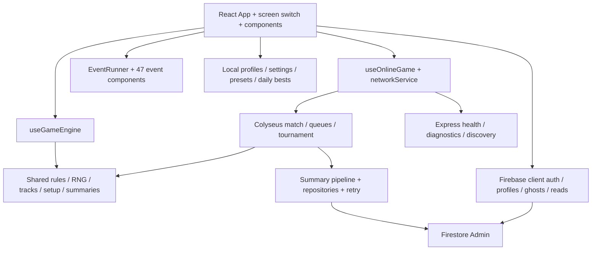

# Conflux Circuit — development-state audit

Audit snapshot: October 15, 2026. Repository: `C:/myProjects/ConfluxCircuit`; HEAD `5a9ab52b387110a4b723cecb8f9b34dcef50b6e2`, branch `main`, including the 30 pre-existing modified files. Those modifications are part of the audited implementation. No application fixes were made during this audit.

## Executive assessment

**State Grade: D — a substantial playable alpha with serious integrity and completion gaps.** The app contains 47 implemented mini-games, a shared race engine, persistent progression, multiplayer rooms, matchmaking, customization, and extensive supporting UI. Breadth is much stronger than end-to-end reliability. Several advanced modes cannot be reached from the lobby; authoritative online handlers accept invalid commands; progression can diverge between server, browser, and stored profile.

**FACT:** 210 client/shared tests and 76 server tests pass. Client type checking, server compilation, and the production client build pass. Lint fails with one error and 98 warnings. Eleven isolated probes confirm defects despite the passing suites. **INFERENCE:** current tests establish useful rule-level correctness but substantially overstate confidence in complete player journeys.

No component is assigned 96–100%: there is no evidence of battle-tested operation, comprehensive browser coverage, or production observability. Percentages below are engineering judgments against the requested rubric, not measured coverage or arithmetic estimates of remaining hours.

## Evidence, scope, and limits

- [Component and file inventory](C:/myProjects/ConfluxCircuit/audit/COMPONENT_INDEX.md): every scanned file, all registered events, symbols, imports, and component-level qualifications.
- [Machine-readable file index](C:/myProjects/ConfluxCircuit/audit/file-index.json): 192 files; 165 JS/TS source/config/test files. Import reachability is static reachability from application/server entry points, **not** proof of a navigable UI or correct execution.
- [Event inventory](C:/myProjects/ConfluxCircuit/audit/event-index.json): 47 registry entries, component files, purposes, durations, scoring descriptors, randomness and pause references.
- [Defect reproductions](C:/myProjects/ConfluxCircuit/audit/diagnostics.json), [probe source](C:/myProjects/ConfluxCircuit/audit/diagnostics.cjs), [execution log](C:/myProjects/ConfluxCircuit/audit/diagnostics.log): in-memory/local calls; a passing probe means the defect was reproduced.
- [Scoring comparison](C:/myProjects/ConfluxCircuit/audit/scoring-parity.json): 9,306 sampled client/server scoring inputs, zero mismatches. This does not establish that event metrics are fair or that untrusted telemetry is rejected.
- [Client tests](C:/myProjects/ConfluxCircuit/audit/client-tests.log), [server tests](C:/myProjects/ConfluxCircuit/audit/server-tests.log), [client build](C:/myProjects/ConfluxCircuit/audit/client-build.log), [server build](C:/myProjects/ConfluxCircuit/audit/server-build.log), [type check](C:/myProjects/ConfluxCircuit/audit/client-types.log), [lint](C:/myProjects/ConfluxCircuit/audit/lint.log), [client dependency audit](C:/myProjects/ConfluxCircuit/audit/client-dependencies.json), [server dependency audit](C:/myProjects/ConfluxCircuit/audit/server-dependencies.json).
- Browser smoke test with mock Firebase: created a local pilot, opened Workshop, saw 47/47 events, launched Reaction Tap and reached its timeout result. [Screenshot](C:/myProjects/ConfluxCircuit/audit/playtest-result.png). This validates that path only, not all events, full races, multiplayer browser synchronization, or deployed Firebase.

The scan excludes installed dependencies, generated build trees, audit output, private environment values, prompt-history content, and the ignored `cc1.zip` archive. Their presence is inventoried below; their contents are not certified. No live cloud data was modified, no deployment was performed, and remote branches were not fetched. Deployment health, real credentials, Firestore indexes, service quotas and production exploitability remain unverified.

## 1. Component index and progress matrix

Statuses: **Partial** = integrated but incomplete/fragile; **Integrated** = mostly functioning implementation requiring hardening; **Stubbed** = placeholder; **Deprecated** = retained legacy/orphaned structure. “Yes” means a code or UI access path exists, not that the entire workflow succeeds. Per-file and per-event details are in the companion index.

| Component / purpose | Status / completion | Reachability | Dependencies and missing pieces / duplication |
|---|---:|---|---|
| Application coordinator — navigation, profiles, race lifecycle | Partial 55% | Yes: `index.tsx` → `App.tsx` | React hooks, local/online engines; 897-line coordinator, duplicate phase/navigation logic; mode entries disconnected |
| Local lobby and race configuration | Partial 65% | Yes: Lobby | profile, settings, presets, chassis; custom event pool ignored on initial start; loose imported settings validation |
| Shared race rules — movement, rewards, status effects | Integrated 70% | Yes: local and server adapters | `shared/gameRules.ts`; broad unit tests, but force-overdrive duplication, energy semantics and mode divergence remain |
| Seeded RNG and track generation | Partial 45% | Yes: every race | `shared/seededRNG.ts`, `pathGenerator.ts`; three-tile infinite loop; no bounded malformed-input contract |
| Event registry and scoring | Integrated 65% | Yes: Workshop and races | `events/eventRegistry.ts`, server descriptors; 47 matching scorers; manually duplicated metadata and no canonical runtime clock |
| Event runtime, countdown and HUD | Partial 45% | Yes: EventRunner/Countdown/RaceTrackHUD | independently owned event/HUD/server clocks; wrong online human identity; accessibility and timeout mismatch |
| 47 mini-games | Partial 40–65% each | Yes: Workshop; generated races | Individual inventory below; no event-level browser suite; selected concrete defects in §3 |
| Workshop, presets, practice and explanation | Partial 60% | Yes: Open Workshop | EventList, EventPlaytestRunner, ExplainEventModal, presetService; practice usable, saved selections do not govern fresh race |
| Tile results and final results | Partial 50% | Yes: race transitions | TileResultsScreen/ResultsScreen; summary availability and human selection unreliable online |
| Local pilot accounts and migration | Partial 50% | Yes: PilotProfileSetup/Lobby | profileService/localStorage; browser account ID disconnected from anonymous auth UID; CP migration can restore spent currency |
| Anonymous auth and cloud profile sync | Partial 35% | Yes when configured | Firebase client/Admin, full profile writes; no stable account binding or constrained progression ownership |
| Match summary / CP / streak / mastery pipeline | Partial 35% | Yes: finishRace/finalizeRace | shared summary + server repositories; summary recomputation changes identity/rewards; no durable recovery |
| Accolades and persistent rival history | Partial 55% | Yes: AccoladesScreen and race | ten definitions, profile/summary and rival traits; ghost/tournament accolades blocked by modes; online summary divergence |
| Contracts, corporations and sponsorship reputation | Partial 55% | Yes: race/lobby | contractService, summary, three corporations; ghost can inherit stale contracts; intervention CP promises disconnected |
| Rival AI, personalities and banter | Partial 65% | Yes: bot races | shared/botMind, rivalBanter and adapters; stale delayed snapshots and inconsistent application across modes |
| Power-ups, energy, overdrive and debuffs | Partial 50% | Yes: HUD / commands | shared rules/config; client force privilege; repeated activation; seasonal restriction incomplete |
| Tile modifiers, anomalies and interventions | Partial 50% | Yes: generated races | seven modifiers/nine anomaly definitions and intervention modal; Cosmic Storm authority, timing and local/online ordering drift |
| Pit stops | Partial 35% | Yes: race every fourth tile | shared rules + server handler; no explicit server subphase or robust deadline, malformed/arbitrary-time action accepted |
| Five chassis / purchasing | Partial 60% | Yes: lobby/Hangar | CP/profile/gameSetup; duplicate purchase paths and selection persistence gaps |
| Skill tree — 15 nodes, three trees | Partial 60% | Yes: SkillTreeScreen | profile/gameSetup/rules; effects now implemented, energy descriptions differ from math; server trusts submitted unlocks |
| Modules — nine modules, three slots | Partial 55% | Yes: Hangar | profile/loadouts/gameSetup; ownership and slot contracts unenforced online, mutation/undefined persistence risks, balance dominance |
| Syndicate perks and standing | Partial 55% | Yes: local Lobby/race | sponsorship reputation and gameSetup; applied in local setup, absent from equivalent online setup |
| Daily challenge and weekly cups | Partial 45% | Yes: Lobby | dailyChallengeService, presets, scores; local/UTC day disagreement, daily cloud path invalid, personal best browser-global |
| Gauntlet | Partial 45% | Yes: Lobby | separate hook implementation, lives and 50-tile run; skips normal setup/rules, rematch initializes normal race, cloud leaderboard disconnected |
| Seasonal modifiers — six definitions | Partial 40% | Implicit: calendar lookup | constants/gameSetup/rules; scheduled only weeks 1–22, non-ISO week calculation, incomplete enforcement and no pinned match season |
| Online lobby, room creation/join/discovery/moderation | Partial 60% | Yes: OnlineLobby | networkService, auth, REST + ConfluxRoom; broad functionality, runtime payload validation/ownership gaps |
| Authoritative multiplayer room | Partial 35% | Yes: `conflux_match` | 1,274-line ConfluxRoom, rules, validator; invalid telemetry still scored, phase skips, timing and durable state gaps |
| Matchmaking, ranked and unranked queues | Partial 50% | Ranked UI; both server room types | MatchmakingRoom; reservation retry and reentrancy guard exist; timeout leaves server queued, client ratings trusted, rank eligibility wrong |
| Rank / tier calculation and badges | Partial 30% | Yes: queues/profile | rankSystem, pipeline, RankBadge; zero-based placements passed into one-based formula, casual ratings affected, live summary omits rating delta |
| Connection status, ping and reconnect | Partial 40% | Yes: online hooks/indicator | sessionStorage token, network singleton; handlers overwrite subscribers, first reconnect failure deletes retry credential, replay cache lacks match scope |
| Spectating | Partial 25% | Button exists | spectator overlay/network/room; short room code used as internal ID, missing auth token, locked room admission; no validated complete path |
| Mode selector and onboarding | Partial 25% | No ordinary lobby path | components exist and App cases exist; unused lobby callback / screen never selected; welcome popup is independently reachable |
| Ghost Race | Partial 30% | No ordinary lobby path | GhostRaceScreen, ghost CRUD, hook; unreachable entry, incomplete replay contract, stale ghost state and synthetic fallback |
| Tournament | Partial 25% | No ordinary lobby path; server callable | TournamentScreen/Room/repository; client-reported winner trusted, wrong placement comparison, canceled return timer, no durable restoration |
| Teams and team power-up definitions | Partial 30% | Helper/code path; no complete dedicated UX found | assignTeams/getTeamPositions, team IDs/constants; no verified selection→team victory→persistence journey |
| Leaderboards: all-time / daily / gauntlet | Partial 35% | Yes: LeaderboardScreen | Firestore queries + server writes; daily paths invalid; local/gauntlet publishing absent; errors appear as empty results |
| Match history and replay seed | Partial 45% | Yes: MatchHistoryScreen | server-only history writer, cloud read; local races not published; seed alone lacks full replay/version/config contract |
| Audio, haptics and event feedback | Partial 60% | Yes: sound hooks/effects | audioService external assets + synth fallback, vibration; only ReactionTap uses common event feedback, rhythm games lack actual tone playback |
| Settings, accessibility and reduced motion | Partial 50% | Yes: SettingsScreen | two synchronized storage formats; reduced motion/high contrast conflated with gameplay accessibility; music flag has no complete control |
| Visual shell and procedural nebula | Integrated 70% | Yes: CSS/App/nebulaGenerator | Tailwind, canvas noise, fonts; performance/mobile/accessibility not broadly measured |
| Error boundary, toasts and debug panel | Integrated 65% | Yes: shell/debug control | component errors caught, rule effects shown; no central error reporting, clipboard promise failure unhandled |
| REST health/diagnostics/discovery | Integrated 65% | Yes: four GET endpoints | Express/CORS/matchMaker; health doesn't verify real storage readiness; diagnostics exposes operational metadata; no broad rate limiting |
| Firestore repositories/retries/rules | Partial 40% | Indirect: summary/ghost/tournament | transient retry helper useful; catch-and-return hides failures; unrestricted owner profile fields violate server progression trust |
| Build, test, lint and CI tools | Integrated 65% | npm scripts / GitHub Actions | builds and 286 tests pass; lint excluded from CI; no browser/rules/coverage/release gates |
| Hosting / install manifest | Partial 45% | Configured Firebase/Netlify/Render | multiple targets; manifest without service worker/offline cache; actual deployment not checked |
| Documentation / remediation tracking | Partial 40% | README/TODO/ledger/architecture docs | stale React/event counts and completed-remediation claims; current working changes supersede some ledger entries |
| Compatibility exports / unused scaffolds | Deprecated 15% | Imports or unreachable modules | root type/constants barrels and service wrappers; unused useScreenTransition/shared index/rival export; unused EventStub, empty src directory |

### Definition catalogs and implicitly created systems

`shared/constants.ts` defines five chassis, ten accolades, five rival traits, three corporations, 15 skill nodes, nine modules, six seasonal modifiers, three weekly event-pool presets, bot profiles, power-ups, tile modifiers, anomalies, pit-stop actions, rank/energy/reconnect tuning and team power-up descriptions. Their named entries and purposes are included in the companion index. Definitions alone do not prove the corresponding unlock or mode is complete.

Background work includes room auto-start timers, per-tile countdown/result deadlines, delayed bot actions, reconnect grace timers/backoff, queue processing every two seconds, tournament ticks every three seconds, asynchronous reward/persistence tasks, ping/pong measurement, local event animation loops and timers, transient database retries, and toast/taunt cleanup timers. These are process/browser timers, not durable jobs. No implemented LLM agents, cron service, durable queue, webhook consumer or analytics pipeline was found in the scanned application.

## 2. Behavior gap report

### B01 — Invalid telemetry changes authoritative results (Critical)

**FACT:** `ConfluxRoom.handleSubmitEventResult` logs validator failure but continues computing stars using the submitted `eventId` and metric. Probe submitted tile 999 and Slider Precision's zero-error metric during Reaction Tap; server accepted three stars. `ServerEventValidator` exists, but its result is not an enforcement boundary. Payload shape, seed and timing checks are also insufficient for authenticated gameplay integrity.

**Intended behavior (INFERENCE):** the validator, server scoring descriptors and authoritative room comments imply rejection of invalid submissions. Reject before mutation, derive event from active tile, require finite metrics and a match/tile nonce. Metric plausibility alone cannot prevent fabricated successful play; decide explicitly what level of anti-cheat is achievable.

### B02 — Commands can bypass costs and phase sequencing (Critical)

**FACT:** `handleActivateOverdrive` forwards client-controlled `force`; probe activates with zero energy. Repeating force adds duplicate player IDs and turns a submitted three-star result into zero after repeated conversion. `handlePitStopAction` accepts recharge during active play, grants energy and advances the tile. Unknown action throws TypeError. See `shared/gameRules.ts`, room handlers and diagnostics.

**Intended behavior (INFERENCE):** power and pit costs should obey the displayed rules and active phase. Server-only forced actions require a separate internal entry point. Reject duplicates; encode pit/intervention as explicit states with allowed commands and deadlines.

### B03 — A valid-looking configuration hangs track generation (Critical)

**FACT:** `shared/pathGenerator.ts:assignDifficultyAndModifiers` asks for at least two unique interior positions for a three-tile run, which has one available position. Probe times out after one second; static loop condition explains nontermination. Online settings permit runLength 3. Imported URL settings validate primitive types but not safe bounds/integer values (`services/shareService.ts`).

**Intended behavior (INFERENCE):** every admitted configuration should terminate with a valid run. Sample bounded eligible positions; reject empty event pools, NaN, fractional and unsupported lengths at every ingress. This can block the server event loop, not merely one screen.

### B04 — Independent clocks contradict event contracts (High)

**FACT:** client Countdown's default sequence takes about 4.5s while server start timing uses 3.5s. Server validator duration is fixed at 15s and result timeout at 30s; Code Breaker and Flow Connect can run 35s, several events 30s plus completion delays. Time Dilation alters parent timing without consistently altering event clocks. Several events recreate full-duration timeouts after pause rather than preserving elapsed time.

**Intended behavior (INFERENCE):** one versioned event clock should determine presentation, pause semantics, scoring window and deadline, including accessibility settings and anomaly effects. Current outcomes depend on event and timing rather than a single contract.

### B05 — Online UI selects the wrong human (High)

**FACT:** EventRunner and PitStopScreen select the first non-bot; ResultsScreen selects a human from results rather than resolving the current session's player. Commands are applied by server session identity. A nonhost can therefore see another human's inventory/status/energy while actions target themselves. App passes the unadapted shared game state.

**Intended behavior (INFERENCE):** all player-specific views should receive an explicit localPlayerId resolved from authenticated room identity. Test two distinguishable humans with different inventories and placements.

### B06 — Reward summaries are recomputed after they have been applied (Critical)

**FACT:** `server/src/services/matchSummaryPipeline.ts` computes/applies a summary inside the profile transaction, then computes another against the updated profile for delivery and projections. `computeMatchSummary` derives ID from seed and timestamp. Probe demonstrates persisted `audit-100` versus delivered `audit-101`, streak 1 versus 2, mastery plays 2 after one match, and daily new-best becoming false. The 50-ID application history cannot ensure stable idempotency when IDs change. Transaction retries can also change timestamps.

**Intended behavior (INFERENCE):** one immutable match result and reward receipt must be stored and delivered unchanged. Stable server match IDs, one pre-match profile calculation, transactional receipt creation and replayable projections are required. Current client full-profile sync can overwrite server progression again.

### B07 — Ranking is inflated and eligibility is unclear (High)

**FACT:** pipeline gates rank changes on truthiness of `roomPlayer.rating`, not ranked queue identity. It passes `sortedPlayers.indexOf(p)` into `computeMultiPlayerRatingChanges`, whose score formula expects one-based placement. Equal-rated two-player probe produces +48 and +16, including a positive loser delta. Bots participate with fallback rating 1000; one-player math divides by zero. Shared delivered summary leaves ratingChange/newRating null.

**Intended behavior (INFERENCE):** ranked-only results with an explicit participant set, defined tie/abandon rules and validated placement convention. Rating is loaded from authority, not supplied by joining clients; the receipt includes the exact applied delta.

### B08 — Local account identity and cloud authority conflict (Critical)

**FACT:** browser accounts have local IDs while Firebase uses anonymous UID sessions. Switching/resetting sessions does not restore a stable local-account↔UID mapping. Startup fetch/save and full cloud writes can replace an active local profile. Firestore permits owners to write every field of their profile, while server gameplay accepts submitted rating, skills and modules. Thus currency/unlocks that affect online gameplay are client-editable. `normalizeProfile` takes the larger of stale skills.availableCP and circuitPoints; an old chassis purchase path updates only circuitPoints, allowing spent currency to return on reload.

**Intended behavior (INFERENCE):** versioned identity binding and migrations, one currency balance and explicit ownership rules. Separate cosmetic preferences from authoritative progression. Offline/local progression needs a declared trust model rather than silently sharing ranked authority.

### B09 — Leaderboards and history omit important game modes (High)

**FACT:** daily reader constructs a four-segment collection path; writer constructs a five-segment document path. Both are invalid Firestore references, reproduced locally. All-time and gauntlet path structures differ and are not affected by that exact parity bug. Local daily/gauntlet completion only syncs profile; history/leaderboard rules deny client writes and there is no local submission endpoint. Exceptions often become empty arrays. Daily client helper uses local date; server uses UTC. Personal best storage is shared across browser pilots; dailyBests has no retention bound.

**Intended behavior (INFERENCE):** documented valid collection paths, one day boundary, per-pilot bests, explicit submission eligibility and visible error/offline states. Cloud UI should distinguish “no records” from “read failed.”

### B10 — Reconnect and queue state can disagree with the server (High)

**FACT:** networkService.setHandlers merges into a single callback slot per event. useOnlineGame/useConnectionStatus/tournament consumers can replace each other. First reconnect failure clears the stored token, undermining later backoff attempts. Cached telemetry may be replayed after authoritative results; duplicate suppression tracks tile index rather than match identity and is not reset consistently for rematches. Queue timeout updates client isQueuing=false while the server keeps the player eligible for matching. ConfluxRoom's abandoned-player handling can advance via a pit-stop completion path during ordinary play/results.

**Intended behavior (INFERENCE):** subscriptions with independent unsubscribe, match-scoped command IDs and authoritative snapshots, recoverable reconnect credentials, and one explicit queue-timeout policy. Delayed callbacks must verify match/phase/tile generation before applying.

### B11 — Tournament is scaffolded across several disconnected lifecycles (Critical for that mode)

**FACT:** no ordinary lobby route reaches ModeSelector/Tournament. TournamentRoom has no comparable auth boundary and accepts client victory reports; one report wins on the next tick despite comments suggesting a timeout/check. Contradictory reports have no clear resolution. App compares placement===0 against server one-based placement, identifies player by name, and clears tournamentMatchId in an effect whose cleanup cancels the return timer. TournamentScreen remount loses local joined/subscription state. Match rooms use ordinary defaults rather than a strict two-participant contract; internal room IDs can be uppercased by the room-code UI. `loadTournamentBracket` exists but is unused; persistence is fire-and-forget, with save/delete race potential.

**Intended behavior (INFERENCE):** authenticated participants, server-produced match outcomes, strict child-room admission, persistent bracket/session IDs, reconnect restoration and deterministic advancement. Simply adding a lobby button would expose unresolved integrity failures.

### B12 — Ghosts, spectators, onboarding and team mode lack complete access paths (High)

**FACT:** GhostRace/ModeSelector/Onboarding App cases exist without normal lobby navigation. Ghost fetching selects randomly from the first 20 records, not a verified seed/rating/version match; fallback is synthetic. Ghost data stores stars/metrics, seed and run length without complete track/modifier/chassis/action versioning. Normal/gauntlet initialization does not clear ghostRun; ghost setup does not clear prior contracts. App records primaryMetric 0 when producing ghost history. Spectate uses a short code where joinById expects room ID, omits the normal ID token, and attempts admission to a locked running room; underlying EventRunner still mounts. Team helpers/types exist without a verified complete user journey.

**Intended behavior (INFERENCE):** explicitly supported modes with discoverable navigation and isolation of mode state. Replays need schema/version compatibility and trustworthy identity; spectators need a separate read-only admission contract.

### B13 — Workshop selections, rematches and progression setup drift (High)

**FACT:** Workshop selection is stored in App but fresh Start passes undefined custom event IDs; rematch uses the selection. Rematch invokes normal initializeGame even after gauntlet/ghost. Gauntlet has its own star/lives/energy implementation and bypasses standard skills/loadouts/syndicate/seasonal initialization and overdrive conversion. Shared createPlayers is tested but runtime engines construct players separately. Local players can retain the generic Player 1 name.

**Intended behavior (INFERENCE):** one canonical MatchConfig and player factory, specialized mode rules through adapters, and a rematch that preserves mode/config intentionally. Workshop should configure the next actual race, not only a later rematch.

### B14 — Several events have correctness defects beyond polish (High)

- **FACT — FlowConnect:** random pipes are not guaranteed solvable; source/destination orientation can prevent a path; connection arrays rotate and CSS rotates the visual again. The solved callback schedules a finish closure holding solved=false, producing the failure metric despite success (`events/FlowConnect.tsx`).
- **FACT — BalanceBeam:** durations are 12/10/8s, but scoring uses metric/12 and the top threshold is 0.85; 10s and 8s cannot attain the needed 10.2s. Physics uses a fixed frame step and random perturbation (`BalanceBeam.tsx`, registry scorer).
- **FACT — MazeMicro, ColorMath, SprintMash:** isPaused is accepted but not used to suspend their timer/input logic. Maze timeout uses a completion presentation even when unsolved.
- **FACT — ChordMemory:** description suggests growing rounds; implementation demonstrates one full fixed generated sequence rather than that progression. AudioBeat and DrumEcho provide visual beat/pad logic without actual event tone playback.
- **FACT — Determinism:** BalanceBeam, TypeBurst, EvadeGrid, JumpBar, TargetPractice and AsteroidDodge contain Math.random calls. Identical seeds cannot guarantee identical event challenges. Only ReactionTap adopts useEventFeedback.
- **INFERENCE:** the other events are implemented candidates requiring browser verification, not presumed broken or complete. Static scoring parity does not detect lifecycle, input, mobile or fairness defects.

### B15 — Skill descriptions, season rules and effects need one contract (Medium/High)

**FACT:** all 15 skills and nine modules now have effect consumers; older claims that these are all no-ops are stale. However energyPerStarBonus is added once then rounded rather than multiplied by stars; a 0.25 bonus can disappear and a 0.5 bonus can grant energy even on a zero-star result. Fortified shielding is consumed as one race-level boolean rather than an extra hit for each shield. A cheaper +15% thruster dominates a more expensive +10% thruster. Server loadouts lack ownership/slot validation. Seasonal “no power-ups” strips starting inventory but does not consistently prevent later awards/use. Local setup and online setup apply different season/syndicate rules; date lookup is not pinned for a match.

**Intended behavior (INFERENCE):** descriptions generated from tested effect contracts; explicit balance decisions and whole-match seasonal enforcement. Cosmetic accessibility preferences should not silently change competition timing/scoring.

## 3. As-built architecture map

### Core engine and interaction logic

`shared/gameRules.ts` returns GameUpdate state/effects; browser hook executes audio/haptic/toast effects. Shared RNG and path generation provide seeded tracks. Shared setup applies loadouts, skills, syndicates and season rules, but local/gauntlet/ghost/server factories differ. Event callbacks produce raw metrics; registry scorers translate metrics to stars. Online telemetry goes through room handlers and server scoring descriptors. Full game-state snapshots are sent by explicit messages; presence of `@colyseus/schema` does not mean the state is a fully schema-driven incremental model.

### Data model and state machines

`shared/types.ts` contains GameSettings, Player, Tile, GameState, EventResult, PilotProfile, RoomConfig, telemetry, leaderboard/history records, skills/loadouts/mastery/rank, seasons, ghosts and tournament bracket entities. `shared/matchSummary.ts` contains reward receipt-like structures but lacks stable authoritative identity. Shared server MatchPhase has lobby/countdown/playing/tile_results/finished; client online phases add pit/intervention/disconnected. Pit/intervention are implicit state on the server, producing ambiguous command permissions and reconnect restoration.

### UI and UX

React 19 + Vite + Tailwind; App owns a screen enum rather than a route-based router. Only settings/room query links provide limited URL state. Screens include lobby, profile creation, Workshop, practice, race/HUD/countdown/results/pit, accolades, history, leaderboards, Hangar, skills, settings and online lobby; ghost/tournament/mode/onboarding screens exist but lack ordinary access. Overlays include welcome, explanation, rival intervention/taunt, spectator, toast, error boundary, connection status and debug.

### Storage schemas and authority

| Layer | Implemented schema / keys | Gaps |
|---|---|---|
| localStorage | conflux-circuit-profiles, conflux-circuit-active-profile-id; legacy conflux-circuit-profile migration | local identity not bound to cloud UID; partial normalization, no general schema version |
| localStorage | conflux-game-settings + conflux-circuit-settings; conflux-circuit-presets; conflux-welcome-seen; date-keyed daily best | two settings models, browser-global daily score, corrupt/quota errors mostly hidden |
| sessionStorage | conflux-reconnect-token | deleted on initial reconnect failure; no durable match receipt recovery |
| Firestore profiles | profiles/{uid}, PilotProfile document | owner may write authoritative progression fields; full-profile race with server transaction |
| Firestore leaderboard | leaderboards/allTime/entries/{uid}; leaderboards/gauntlet/entries/{uid}; daily path attempted separately | daily path invalid; no versioned schema/migrations/index declaration found |
| Firestore history | matchHistory/{uid}/matches/{matchId} | server online writes only; unstable match ID and no retention policy |
| Firestore ghosts | ghosts/{uid-seed-timestamp} | broad trusted payload, replay format incomplete; compound seed/order query may need deployed index, unverified |
| Firestore tournaments | tournaments documents via tournamentRepository | save/load/delete helpers exist; load unused, no restart/reconnect restoration |
| Server process memory | rooms, pending results/actions, participant maps, queue entries and timers | lost on process restart; no durable outbox or match journal |

### Network and external integrations

REST endpoints are GET `/health`, `/diagnostics`, `/api/queue/status`, `/api/rooms` in createExpressApp. Middleware: CORS allowlist from ALLOWED_ORIGINS (otherwise permissive), JSON parsing; gameplay auth via verifyAuthToken and per-message token buckets for selected commands. No general route authentication/rate limiter is evident for diagnostic/discovery endpoints.

Colyseus room names: conflux_match, conflux_queue_ranked, conflux_queue_unranked, conflux_tournament. `shared/protocol.ts` enumerates ready/start/cancel/settings, event result/power-up/overdrive/intervention/pit/rematch, spectate/privacy/kick/ban, queue join/leave, tournament join/leave/report, ping; server events cover lifecycle/state/results/errors/summary/presence/moderation/queue/bracket/countdown/pong. Some state messages remain raw string literals (`room:state`, `game:state`) outside the constants catalog.

External dependencies: Firebase anonymous Auth/Firestore and Admin SDK, Colyseus WebSocket/HTTP matchmaking, Firebase/Netlify static hosting, Render backend configuration, Google Fonts, external GCS demo audio URLs and browser audio/vibration/clipboard/canvas APIs. Audio now includes synthesized fallback. No payment integration, external analytics, email workflow or webhook pipeline was found.

### Internal tools, hidden artifacts and drift

- Root npm scripts: dev/start/build/test/lint/lint:fix. Server: dev via transpile-only ts-node-dev, build via tsc, start compiled nested path, test via Vitest. CI runs type/build/test checks for both projects but omits lint, browser tests, Firestore-rule tests and dependency policy.
- `.firebaserc`, firebase.json/firestore.rules, netlify.toml/public redirects and render.yaml encode multiple deployment targets. `.firebase` cache and `.netlify` local state are generated deployment artifacts, not evidence of healthy live deployments.
- `manifest.json` and install/mobile metadata exist; no service worker/cache implementation was found. README offline/PWA claims exceed the implemented behavior; external fonts/assets further limit offline operation.
- Ignored `cc1.zip` (~88 MB), generated dist trees, node_modules, empty src directory, local environment files and a tracked prompt-history artifact exist. Environment values and history contents were not exposed. A gitignore entry does not remove already tracked history.
- Local main matches cached origin/main; cached gitlab/main is 28 commits behind. No other local development branches were observed. This establishes remote drift, not proof that unseen remote work was abandoned.
- Compatibility service exports wrap shared implementations; useScreenTransition, shared/index and rivalBanter export are unused from entry-point import graph. EventStub is lazy-declared but has no registered playable event. These are cleanup candidates, not proof they can all be deleted blindly.
- Hotspots: ConfluxRoom 1,274 lines; eventRegistry 901; shared/botMind 899; App 897; networkService 719; shared/gameRules 712; shared/types 639. Responsibility concentration increases transition and ownership mistakes.
- README names React 18 while installed major is 19, advertises 30+ events while registry has 47, and claims local multiplayer/offline features without a verified full path. Runtime here is Node 24; CI uses Node 20; server engines/README allow older versions. Pin and test supported versions.

## 4. Risk register

| ID | Severity | Exposure / evidence | Required mitigation |
|---|---|---|---|
| R01 | Critical | Invalid telemetry accepted; client force overdrive; arbitrary pit action (§B01–02) | Runtime schemas + rejection, phase guards, server-only privileges, adversarial tests |
| R02 | Critical | Three-tile generator blocks event loop (§B03) | Bounded algorithm and ingress validation before another public release |
| R03 | Critical | Writable progression and client-supplied online advantages (§B08) | Server-owned progression fields; validate loadouts/rating from stored authority |
| R04 | Critical | Reward identity changes and state double computation (§B06) | Immutable receipt, stable match ID, transaction + durable projection recovery |
| R05 | High | Miscomputed/inapplicable rank deltas (§B07) | Explicit queue eligibility, placement contract, bot/tie/single-player policy |
| R06 | High | Wrong player's online UI, stale callbacks and overlapping phases | Explicit player identity and phase machine; generation-scoped callbacks |
| R07 | High | Clocks reject valid long events; pause inconsistency | Canonical event clock and per-event timeout/pause tests |
| R08 | High | Daily invalid path, silent persistence failures, no local publishing | Shared validated storage paths; error states; submission policy and recovery |
| R09 | High | Reconnect token/cache/subscriber and queue state failures | Subscription model, match-scoped dedupe, snapshot recovery, timeout agreement |
| R10 | Critical within mode | Tournament accepts self-reported wins and lacks durable lifecycle | Server outcomes/admission/identity; hide mode until end-to-end gates pass |
| R11 | High | Broken/unreachable ghost/spectator/advanced mode flows | Complete config/navigation/state isolation and real browser journeys |
| R12 | High | Vulnerable dependency trees | Review current npm audit reports and patch compatible chains; validate deployed reachability |
| R13 | High | FIREBASE_AUTH_DISABLED=1 works in production probe | Hard fail production bypass; test process configuration and credential readiness |
| R14 | Medium | Logging only, swallowed repository errors, no durable background tasks | Structured correlated logs, metrics, durable retries, user-visible pending/error states |
| R15 | Medium | Monolithic coordination, duplicate setup/scoring/settings models | Extract contracts after correctness fixes; avoid a broad speculative rewrite |
| R16 | Medium | Large chunks and unmeasured event/canvas performance | Budget and measure real devices; event chunking strategy, cleanup and frame-time tests |
| R17 | Medium | Accessibility, audio, season and module-description mismatch | Test descriptions against behavior; keyboard/touch/reduced-motion checks |
| R18 | Medium | Stale docs/multiple deployment configs/untracked operational assumptions | Choose supported release path; environment schema, smoke checks and restoration runbook |

Dependency scan reports **19 client affected package entries** (2 critical, 12 high, 4 moderate, 1 low) and **43 server entries** (3 critical, 15 high, 21 moderate, 4 low). Trees overlap, include transitive/dev packages, and are not 62 independent exploitable vulnerabilities. Critical package entries include protobufjs and websocket-driver in both trees, plus proxy-addr server-side. Reports preserve advisory URLs and available fixes. No automatic dependency rewrite was performed.

Production omissions: tested cloud rules/indexes, stable identities, payload contracts, durable match/receipt recovery, failure monitoring and alerting, shutdown/restart recovery, retention limits, documented support versions, browser multiplayer coverage and deployment acceptance gates. Existing retries, token buckets, error boundary, health routes and tests provide foundations but do not cover these boundaries.

Over-engineering is concentrated in breadth ahead of shared lifecycle correctness: tournament persistence without restoration, separate ghost/gauntlet/player factories, two scoring catalogs, several progression/config models and compatibility barrels. Underdevelopment is concentrated in authority, clocks, mode admission, identity and recovery. Preserve useful game concepts while reducing the number of independent implementations.

Performance evidence: production build passes; uncompressed chunks include Firebase ~460 kB, app ~234 kB, React ~194 kB and combined events ~145 kB. Vite manual chunking groups event modules, reducing the practical benefit of per-event lazy declarations. No runtime CPU, memory, load or multi-instance measurements were collected; avoid claiming measured latency or capacity. Full snapshots and bot/nebula work are profiling candidates, not established bottlenecks.

## 5. Prioritized next moves blueprint

### P0 — Stabilize authority and prevent corruption

1. **Bound track generation and validate configurations.** Impact: critical server stability; prevents frozen UI/process and malicious settings. Unlocks safe custom/imported/online configurations. **Done:** all supported lengths and empty/invalid inputs terminate under a test budget; no loop depends on impossible unique sampling; URL and server use one schema.
2. **Enforce server command contracts and explicit phase permissions.** Impact: critical fairness/stability; restores credible multiplayer. Unlocks meaningful ranked testing. **Done:** invalid telemetry produces no state mutation; client cannot force costs; pit commands outside pit rejected; unknown/null/nonfinite payloads never throw; duplicate commands idempotent; disconnect cannot skip a phase.
3. **Close progression/auth boundaries.** Impact: critical security and economy integrity. Unlocks trustworthy online customization/rating. **Done:** production bypass rejected; server loads owned skills/modules/rating; rules deny client edits to authoritative fields; emulator tests cover cross-user and owner-field abuse; local/cloud identity policy documented.
4. **Make match completion immutable and recoverable.** Impact: critical data correctness and UX. Unlocks leaderboards, history, ranking, ghosts and tournament outcomes. **Done:** one match ID/receipt; replay and transaction retries cannot change rewards; disconnected clients can retrieve receipt; projection failures observable and retryable.
5. **Repair ranking and daily storage paths.** Impact: high correctness, visible progress restored. Unlocks ranked/daily release. **Done:** one-based placement conversion; explicit ranked eligibility; finite solo/tie handling; exact rating delta in receipt; valid client/Admin daily path parity tested; UTC/local boundary decision shared.

### P1 — Complete the tools already present

6. **Unify event clock and local player identity.** Impact: high fairness/UX, fewer premature timeouts. Unlocks reliable multiplayer browser tests. **Done:** shared start/deadline/pause contract; longest/accessibility events fit deadlines; two humans see their own status; rematch resets every command/cache generation.
7. **Finish Workshop → practice → configured race → rematch.** Impact: high UX and event development speed. Unlocks a dependable event QA workbench. **Done:** selected pool used on first start and rematch; bad presets rejected; replay reset deterministic; completion/timeout/pause verified; each event's scoring boundaries attainable.
8. **Repair known event correctness failures, then verify all 47.** Impact: high player trust. **Done:** FlowConnect generated solvable and success metric correct; BalanceBeam top score attainable at every difficulty; pause honored consistently; seeded challenge replay passes; keyboard/touch and timeout checks recorded per event.
9. **Finish mode contracts one at a time: gauntlet, ghost, spectator, tournament.** Impact: high feature completeness; avoids exposing broken navigation. **Done for each:** discoverable entry, strict admission/config, correct setup, complete play/reward/rematch, reconnect/leave, error states and end-to-end test. Tournament additionally requires server-decided outcomes and durable restoration. Team mode remains gated until equivalent acceptance criteria exist.
10. **Stabilize profile switching, purchases and cloud/offline policy.** Impact: high trust/retention. **Done:** switching never overwrites another pilot; single currency ledger; migrations cannot refund purchases; module slot/ownership validation; all UI selection changes persist; cloud failures have recoverable UX.

### P2 — Improve structure, performance and operations

11. **Extract canonical MatchConfig/player setup/event descriptors and subscriptions.** Impact: maintainability high, correctness medium; fewer mode-specific bugs. **Done:** local/server/mode adapters share tested setup, event metadata generated/shared, independently unsubscribable network listeners; App/ConfluxRoom reduced by responsibility with behavior preserved.
12. **Add production acceptance gates and observability.** Impact: stability high; unlocks confident releases. **Done:** lint clean and required in CI; real browser two-player tests; Firestore emulator rules/path tests; structured match-correlated logs, persistence failure metrics, basic alerts, crash/restart recovery drill and deployment smoke test.
13. **Patch dependencies and measure client/server budgets.** Impact: security high; performance depends on measurement. **Done:** advisory triage recorded, compatible patches tested, supported Node version pinned; bundle/frame/memory/room-load baselines; event chunks load as intended; timer cleanup verified during navigation.
14. **Reconcile docs, dead code, settings and hosting.** Impact: DX/UX medium. **Done:** one release runbook, truthful capabilities, obsolete scaffolds removed after reference checks, preference semantics separate from gameplay accessibility; documented storage retention and recovery.

### P3 — Expand after foundations pass

15. **Expand seasons, balanced modules, team play, richer ghosts and event content.** Impact: player value high only after reliable progress. **Done:** each new concept has an explicit user journey, shared contract, fairness/balance criteria, telemetry and rollout gate. Avoid adding event count while existing success and reward paths remain inconsistent.

## 6. My chosen completion target: match completion and progression

I would take ownership of **the partially finished match-summary/persistence toolchain** first, after the small P0 command/generator safety fixes. It touches every finished race and determines whether players can trust currency, streaks, mastery, history, ranking and leaderboards. Finishing it provides a stable outcome contract for the advanced modes instead of requiring each mode to reinvent rewards.

The shortest path to end-to-end excellence is: stable result identity → one atomic reward receipt → unchanged delivery → recoverable projections → explicit UI pending/error/retrieval. Preserve shared reward calculations; remove post-commit recomputation and unrestricted client overwrites.

### Exact next ten proposed commits

1. **test: reproduce reward divergence and unstable match identity.** Add focused pipeline tests with transaction retry, duplicate finish and disconnect cases; assert persisted/delivered equality. These should fail before fixes.
2. **feat: assign immutable server match IDs and version outcome records.** Create ID at start, preserve through reconnect, create a fresh one on rematch; freeze completion time and participant identity/config/version.
3. **fix: compute and persist one reward receipt per player per match.** Transaction reads pre-match profile, checks stable receipt ID, computes once and stores updated profile plus receipt atomically. Duplicate completion returns existing receipt.
4. **fix: deliver the stored receipt without recomputing rewards.** Change pipeline result/API so both room message and retrieval read the same record; include profile revision and exact deltas.
5. **fix: apply ranked results through an explicit eligibility contract.** One-based placements, tie/solo/bot policies, authoritative ratings; include delta and new rating in receipt and history.
6. **fix: centralize valid leaderboard/history paths and day keys.** Share path builders between client/Admin; test reference parity with emulator/SDK; define daily/gauntlet eligibility and whether local unverified scores belong on global boards.
7. **feat: persist projection work and retry it idempotently.** Receipt records pending leaderboard/history operations; recover after process failure; expose bounded retries/final errors. Avoid relying solely on detached Promise.allSettled.
8. **fix: restrict client progression writes and reconcile profile revisions.** Separate preferences from server-owned fields; add rule tests and a migration/reconciliation path for existing local profiles and CP mirrors.
9. **feat: recover pending match rewards in results and reconnect UI.** Show saved/pending/failed states; retrieve by authenticated player/match ID; prevent a stale summary from applying to a different pilot or rematch.
10. **test: gate the complete finish-to-profile journey and document recovery.** Browser + Firestore emulator tests across normal online finish, duplicate/retry, disconnect, rematch, day rollover and projection outage; metrics and operational runbook included.

### Proof that this tool is fixed

- Persisted receipt equals delivered/retrieved receipt byte-for-byte after serialization; **zero** recomputation differences.
- Repeating finalization 100 times, including transaction retries and process recovery, grants exactly one reward/streak/mastery/rating update per match/player.
- Failed projection jobs recover without duplicate history or incorrect best-score replacement; no acknowledged receipt is lost on restart.
- Unauthorized/cross-user writes and owner edits to rank/currency/unlocks are rejected by rules tests.
- Two-human browser tests show each pilot's own reward, inventory and rating; rematch creates a distinct receipt; profile switching cannot consume another pilot's receipt.
- Instrument completion latency, pending receipt age, projection failure/retry count, duplicate finalization count and client/server revision mismatch. Establish baseline first; proposed acceptance target is p95 receipt delivery under 2s in a healthy staging environment, with a clear pending state during longer outages. This is a future target, not measured current performance.

## 7. Final maturity grade

| Dimension | Grade | Rationale |
|---|---|---|
| Completeness | C | Rich implemented breadth and a working practice path; several flagship modes disconnected or incomplete |
| Correctness | D | Eleven reproduced defects include event-loop hang, command bypass, invalid persistence paths and reward/rank corruption |
| Coherence | C− | Shared rules are a sound direction; setup, timing, authority and phase logic diverge across modes |
| Observability | D | Logs/health/debug UI exist; no evidence of durable job tracking, correlated production metrics or recovery coverage |
| Maintainability | C− | Type checking and 286 passing tests help; monolithic hotspots, stale docs, duplicate contracts and missing journey tests limit confidence |

**Overall: D.** The application is worth completing: the event library, shared rules and customization concepts provide substantial material. The next maturity jump comes from making a finished race trustworthy and recoverable, then applying that contract to each tool and mode. A passing build and visible screen are entry criteria; a stable, correct, observable complete user journey is the completion criterion.
